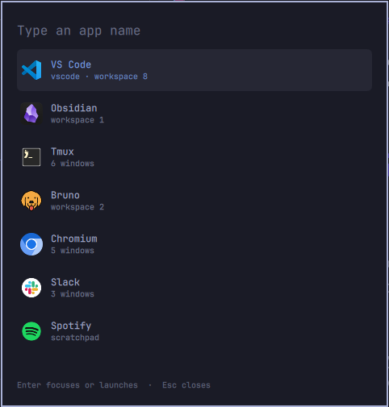
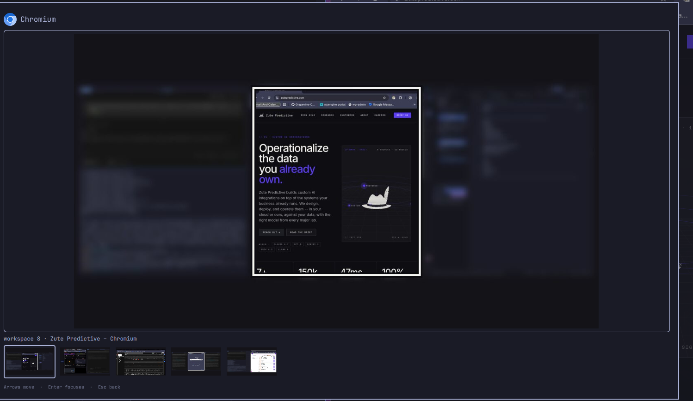

# App Focus

Type an app name. One open window is focused, including a window on another workspace or a hidden scratchpad. Several windows open a second step with a screenshot of each one, on the monitor it is actually on. Obsidian, VS Code, and Tmux launch when nothing is open.

This is an [Omarchy](https://omarchy.org) shell overlay. Installing it does not change any key. The bind stays in your Hyprland config.





## What it is not

A search for "switcher" in the [Omarchy plugin catalog](https://plugins.omarchy.org/index.html?q=switcher#catalog) is mostly two other jobs:

- Alt+Tab switchers cycle windows you already have open. Better Alt-Tab, WindowPeek, Glass Dock, and the Alt-Tab galleries are this.
- Workspace switchers preview desktops and move you between them.

[Jump To](https://plugins.omarchy.org/plugin.html?id=dev.cstav.omarchy.plugin.jump-to) lists apps that already have a window, then drills in by title. [Quick Apps](https://plugins.omarchy.org/plugin.html?id=andean-bridge.quick-apps) launches or focuses a learned set of favorites. App Focus is the named shortcut: type `obsidian`, `vscode`, or `tmux`, launch it if it is closed, reveal a scratchpad before focus, and pick among several windows from screenshots, including windows you cannot see.

## Install

Requires Omarchy on the Quickshell shell, Hyprland 0.56 or newer, `grim` 1.5 or newer, and ImageMagick (`magick`).

```bash
omarchy plugin add https://github.com/lateralcoders/omarchy-app-focus.git --enable
```

The plugin runs unsandboxed inside `omarchy-shell`, like every other shell plugin. Read the source before you enable it.

Check that the key you want is free:

```bash
omarchy menu keybindings --print
```

Add the bind from `examples/bindings.lua` to `~/.config/hypr/bindings.lua`. Hyprland reloads on save. Confirm it with:

```bash
hyprctl reload
hyprctl configerrors
```

Open it without a key:

```bash
omarchy-shell shell toggle io.github.lateralcoders.app-focus
```

## Use

| Key | Apps | Windows |
| --- | --- | --- |
| Type | Filter the list | |
| Up / Down | Move | |
| Left / Right | | Move between screenshots |
| Enter | Focus one window, launch if none are open, or open screenshots when there are several | Focus the screenshot in front |
| Click a row | Same as Enter | First click selects, second click focuses |
| Click the large screenshot | | Focus it |
| Esc | Clear the filter, then close | Back to the app list |
| Click outside, including another monitor | Close | Close |

Enter on an empty filter repeats the last app, and the list puts that app first. Each row shows the app's desktop icon. Tmux uses the terminal icon, because those windows are the terminal. A missing icon falls back to the app's initial.

The window row is most recently focused first. A screenshot is that window on its own monitor. Other apps on that monitor stay blurred, and a light box marks the one you would focus. In the thumbnail row, the selected window is the one with the border. Previews for apps with several windows start as soon as the list is on screen.

`grim -T` captures a window's own surface, so a window on another workspace or a hidden scratchpad still has a picture. Tmux is recognized from the terminal's process tree, so those windows are not lumped in with every other terminal.

## Dependencies

Already present on a normal Omarchy install. The plugin does not install packages, and it does not need sudo.

- Hyprland (`hyprctl`)
- `grim` 1.5 or newer, for window screenshots
- ImageMagick (`magick`), for the monitor composite and a placeholder if a capture fails
- Python 3, standard library only (`python3 -I`)

Screenshots are written under `$XDG_RUNTIME_DIR/hypr-focus/previews/` and removed on the next capture. The last-used app is stored in `$XDG_RUNTIME_DIR/hypr-focus.json`.

## Launch commands

Stock launches:

| Name | Command |
| --- | --- |
| Obsidian | `uwsm-app -- obsidian` |
| VS Code | `uwsm-app -- code` |
| Tmux | `omarchy-launch-terminal-tmux` |

Replace any of them in `~/.config/omarchy-switcher/launches.json`. Each value is an argv list. The plugin reads this file and does not create or change it.

```json
{
  "tmux": ["/home/you/.config/tmux/launch-work-view.sh"]
}
```

Other apps are listed only while they have a window. They are not launched from here.

## Remove

```bash
omarchy plugin remove io.github.lateralcoders.app-focus
```

Delete the bind from `~/.config/hypr/bindings.lua` yourself. The plugin never writes that file. `launches.json` is left in place.

## License

[MIT](LICENSE). Copyright 2026 Zute Predictive.
